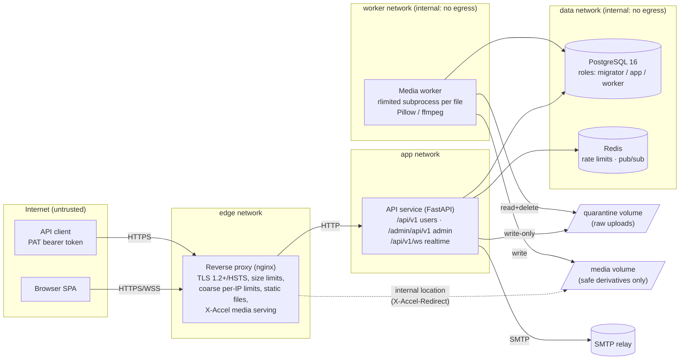
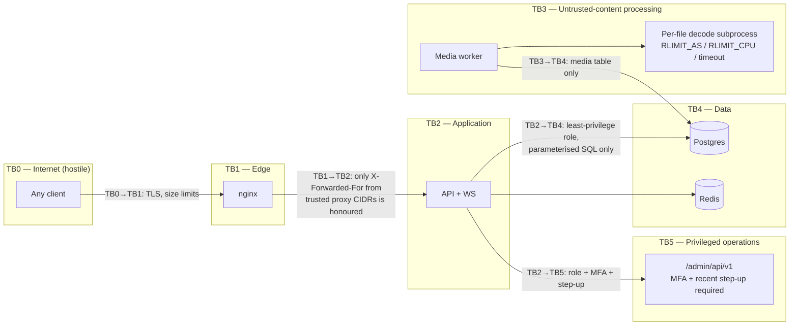

# Bastion — System Architecture

> Design principle: **assume every component will eventually be attacked.**
> Minimise attack surface, isolate failures, validate every boundary.

This document covers the system architecture, data flows and trust boundaries.
The threat model built on top of it is in [`THREAT-MODEL.md`](../THREAT-MODEL.md).

---

## 1. System architecture



### Components

| Component | Responsibility | Privileges | Why it is separate |
|---|---|---|---|
| **Reverse proxy** | TLS termination, HSTS, request-size ceiling, connection limits, static asset serving, media serving via `X-Accel-Redirect` | No DB access, no secrets except the TLS key | Absorbs malformed traffic first, and slow clients never reach Python |
| **API service** | All business logic and authorization (HTTP + WebSocket) | DB role `bastion_app`: DML on app tables, **INSERT/SELECT only** on `audit_log`, no DDL | The single enforcement point for authorization |
| **Media worker** | Decodes and re-encodes untrusted media | DB role `bastion_worker`: SELECT/UPDATE on `media` **only**. No Redis, no SMTP, no secrets | Image/video decoders are the most exploitable code in the stack, so they run in a separate process with minimal privilege |
| **PostgreSQL** | System of record, constraint enforcement, audit chain | Never published outside the data network | Constraints are the last line of defence against application logic bugs |
| **Redis** | Rate-limit counters, realtime pub/sub | Password-protected, internal-only | Holds only ephemeral data: losing it fails *safe* (see §Failure modes) |
| **Migrator** (one-shot job) | Runs Alembic migrations | DB role `bastion_migrator` (schema owner) | The application runtime can never alter the schema |

### Replaceability

Every infrastructural dependency sits behind a small interface, so it can be swapped
without touching business logic:

| Interface (`backend/app/…`) | Default implementations | Swap examples |
|---|---|---|
| `ratelimit.Limiter` | `RedisLimiter`, `MemoryLimiter` | Envoy RLS, Memcached |
| `realtime.Broker` | `RedisBroker`, `LocalBroker` | NATS, Postgres LISTEN/NOTIFY |
| `mailer.Mailer` | `SMTPMailer`, `OutboxMailer` (dev/test) | SES, Postmark |
| `media_store.Storage` | Local volumes | S3 + CloudFront signed URLs |
| `media_worker` | Poll loop over the `media` table (`FOR UPDATE SKIP LOCKED`) | Queue-driven (SQS) worker, a separate microservice |

The API is versioned (`/api/v1`) and documented as OpenAPI, so the SPA can be replaced
by any client.

---

## 2. Data-flow diagram (level 1)

```mermaid
flowchart TB
  U((User)) -->|1 credentials / passkey assertion| AUTH[Auth endpoints]
  AUTH -->|2 argon2id verify, TOTP / WebAuthn verify| DB[(PostgreSQL)]
  AUTH -->|3 Set-Cookie __Host-bastion_sid<br/>+ CSRF token in body| U
  U -->|4 JSON + cookie + X-CSRF-Token| API[Resource endpoints]
  API -->|5 session lookup by SHA-256 hash| DB
  API -->|6 policy check + visibility-filtered SQL| DB
  API -->|7 events: recipient list computed server-side| BR[Broker]
  BR -->|8 per-user fan-out| WS[WebSocket gateway]
  WS -->|9 JSON event frames| U
  U -->|10 raw bytes, no filename| UP[Upload endpoint]
  UP -->|11 magic-byte sniff, size cap| QV[/quarantine/]
  UP -->|12 media row state=pending| DB
  WK[Media worker] -->|13 claim job SKIP LOCKED| DB
  WK -->|14 decode in rlimited subprocess| QV
  WK -->|15 re-encoded derivative| MV[/media/]
  U -->|16 GET /api/v1/media/:id/:variant| MS[Media endpoint]
  MS -->|17 authz: owner / post visible / DM member| DB
  MS -->|18 X-Accel-Redirect → nginx serves file,<br/>sandbox CSP, nosniff, fixed Content-Type| U
  API -->|19 audit_log append (hash-chained)| DB
  API -->|20 JSON security events, redacted| LOG[(stdout → log pipeline)]
```

Sensitive data classes and where they live:

| Data | Stored as | Leaves the server? |
|---|---|---|
| Password | argon2id hash | Never |
| Session token | SHA-256 hash in `sessions` | Only in a `__Host-` HttpOnly cookie |
| API token (PAT) | SHA-256 hash, prefix shown for identification | Shown once at creation |
| Email verification / reset token | SHA-256 hash, purpose-bound, single-use | Only in the email link |
| TOTP secret | AES-256-GCM ciphertext (field-encryption key from secret store) | Shown once at enrolment |
| Recovery codes | SHA-256 hash (codes carry 80 bits of entropy) | Shown once |
| Passkey public key | Plain (public data) | No |
| Email address | Plain, unique (lower-cased) | Only to its owner |
| DM content | Plain in DB (TLS in transit, disk encryption at rest) | Only to conversation members |
| Client IP | Truncated to /24 (IPv4) or /48 (IPv6) on session records; full IP only in short-retention security logs | No |

---

## 3. Trust boundaries



What crosses each boundary, and what is checked there:

| Boundary | Crossing data | Checks at the boundary |
|---|---|---|
| **TB0→TB1** | HTTP/1.1, HTTP/2, WebSocket | TLS; body ceiling (`client_max_body_size`); header size limits; per-IP connection limits; timeouts against slowloris |
| **TB1→TB2** | Proxied request | App trusts `X-Forwarded-For` **only** from `TRUSTED_PROXIES`; duplicate query keys rejected; strict JSON (no duplicate keys, no NaN, max depth 32); per-route body limits; `Content-Type` enforcement; Origin check on unsafe methods and WS handshake |
| **TB2 internal** | Authenticated principal → resource | Central policy (`authz.py`) on every operation; visibility filters built into every list query |
| **TB2→TB5** | Admin/moderator operations | Separate router; `moderator`/`admin` role; MFA enrolled **and** step-up within the last 15 min; shorter session idle timeout; typed confirmation for destructive actions; every action audited |
| **TB2→TB3** | Untrusted file bytes | The API never decodes media. It only sniffs magic bytes and writes to quarantine |
| **TB3→TB3'** | Per-file decode | Fresh subprocess with memory/CPU/file-size rlimits and a wall-clock timeout; Pillow `MAX_IMAGE_PIXELS`; header-declared dimensions checked before decode |
| **TB2/TB3→TB4** | SQL | Parameterised only (SQLAlchemy Core/ORM); per-service DB roles; `audit_log` protected by trigger and privileges |

**Untrusted even though "internal":** Redis contents (rate-limit counters may be
missing or wrong, so we fail closed on sensitive routes), pub/sub payloads (the WS
gateway re-checks that the event's recipient is the connected user), and media rows
(the API re-validates `state`, `content_type` and `owner` before serving).

---

## 4. Request pipeline (order matters)

1. `RequestContextMiddleware`: assigns a request ID and resolves the client IP (trusted-proxy aware).
2. `BodyLimitMiddleware`: rejects on `Content-Length` early, and counts streamed bytes for chunked bodies.
3. `QueryPollutionMiddleware`: rejects duplicate query keys and oversized query strings.
4. `SecurityHeadersMiddleware`: CSP, HSTS, nosniff, Referrer-Policy, Permissions-Policy, COOP/CORP, `Cache-Control: no-store` for API responses.
5. Router dependencies:
   - `strict_json` body parsing
   - `current_principal` (cookie session **or** bearer PAT, never both)
   - `csrf_protect` (cookie auth + unsafe method)
   - `rate_limit(<bucket>)`
   - `require(<permission>)`
6. Handler → service layer → policy checks → parameterised queries.
7. Exception handlers: a uniform `{"error": {"code", "message", "request_id"}}` body. No stack traces or DB errors reach clients.

---

## 5. Key design decisions

| Decision | Rationale |
|---|---|
| **Plaintext UGC only**, with entities (mentions, hashtags, links) extracted server-side and rendered client-side with `textContent`/`createElement` | The whole stored-XSS/Markdown/HTML-injection class is removed instead of being sanitised. There is no HTML sanitiser to bypass |
| **Trusted Types enforced** (`require-trusted-types-for 'script'; trusted-types 'none'`) | Every string-to-DOM-sink assignment (`innerHTML`, `eval`, …) throws in supporting browsers, which blocks DOM XSS even if a developer slips |
| **Raw-body uploads** (`PUT` bytes, no multipart) | No multipart parser, no client filename, no client MIME type to trust |
| **Re-encode all media from decoded pixels** | Polyglots, embedded scripts, EXIF/GPS metadata and malformed chunks do not survive |
| **SVG rejected entirely** | SVG is a document format that can carry script. Rasterising it safely requires a full XML/CSS engine, which isn't worth the surface |
| **UUIDv4 identifiers everywhere** | Non-enumerable. Authorization still never relies on this |
| **Opaque server-side sessions** (not JWTs) | Instant revocation, rotation, device list. No algorithm-confusion class |
| **`__Host-` cookie prefix** | Cookie must be `Secure`, `Path=/` and have no `Domain`, so subdomains cannot plant or overwrite it (anti-fixation) |
| **CSRF: synchronizer token + Origin check + SameSite=Lax + JSON-only** | Defence in depth: any one layer suffices for known browsers |
| **WS messages carry no side effects except typing indicators**; all writes go through HTTP | The WebSocket gateway is a read-only fan-out. Spoofing or replaying client frames cannot change state |
| **Recipients of realtime events computed server-side** | There is no client-chosen channel that could leak another user's data |
| **Visibility enforced in SQL** (`visible_posts_clause(viewer)`) *and* re-checked per object | List endpoints and single fetches share one definition of "visible", so no alternate path leaks |
| **Blocks return 404** for the blocked party's view of content | No block oracle. Consistent with "not found" for private content |
| **Audit log: hash chain + DB trigger + INSERT-only grant** | A compromised app role cannot rewrite history, and tampering by a DBA is detectable with `verify-audit` |
